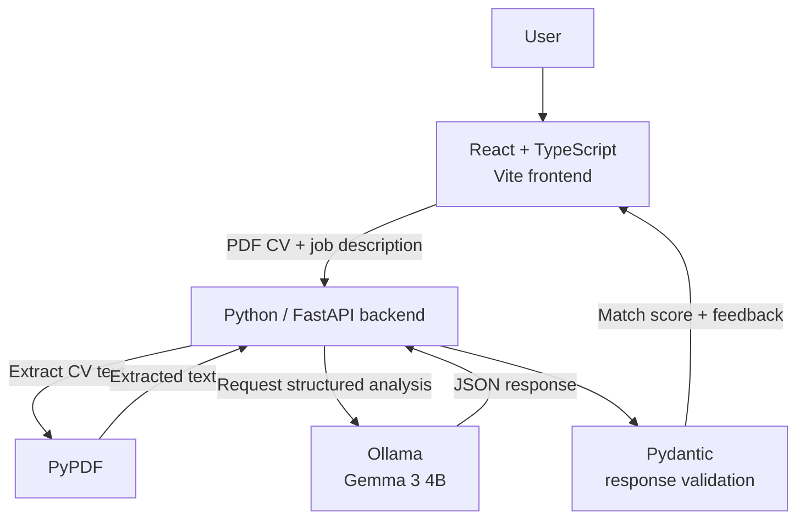
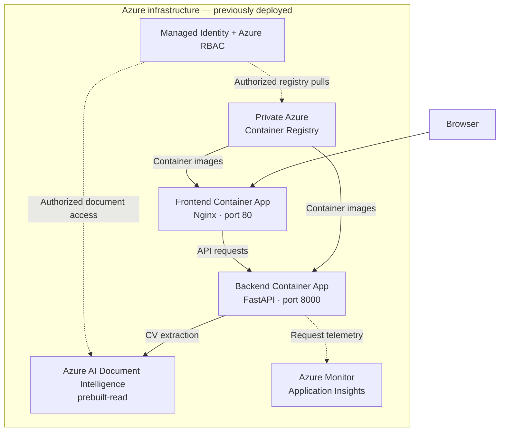

# AI Career Copilot

[](https://github.com/Omarion98/Job-Analyzer/actions/workflows/ci.yml)

**Upload a CV, paste a job description, and discover which skills match, what's missing, and what to prepare for next.**

AI Career Copilot is a full-stack application I built to explore two challenges: using language models to provide practical job-preparation feedback, and engineering a complete AI application around the model—from the interface and API to cloud deployment and monitoring.

## Watch the demo


https://github.com/user-attachments/assets/980be699-0871-4f3a-9109-42b928321c49


> **Current availability:** The app runs locally without an Azure subscription. Its Azure Container Apps deployment was previously built and tested, but is now paused after the Azure free trial ended.

## What the application does

1. **Compare a CV with a job:** Upload a PDF CV and paste a job description.
2. **Understand strengths and gaps:** Receive a match score alongside strong matches, partial matches, and missing skills.
3. **Prepare for interviews:** Review technical interview topics, learning priorities, and a short overall assessment.

The backend also supports analyzing a job description without a CV.


## What I built

Rather than stopping at an LLM prompt, I built the surrounding application and infrastructure:

| Area | What I implemented |
| --- | --- |
| **Full-stack application** | React/TypeScript interface and a Python/FastAPI backend with input checks and API error handling. |
| **Structured AI responses** | Schema-guided generation with Ollama and Pydantic validation before returning results to the frontend. |
| **Switchable integrations** | Local PyPDF or Azure AI Document Intelligence for CV text extraction; separate LLM provider module for model-specific code. |
| **Cloud deployment** | Separate Docker images, private Azure Container Registry, and frontend/backend Azure Container Apps. |
| **Cloud security** | Managed Identity and role-based access (RBAC) for Azure Document Intelligence and private container image pulls. |
| **Observability** | OpenTelemetry spans for PDF extraction, prompt construction, model generation, and validation, exported to Application Insights when configured. |
| **Continuous integration** | GitHub Actions workflow for backend checks, frontend build, and both Docker image builds. |

**Technologies:** Python · FastAPI · Pydantic · React · TypeScript · Vite · Ollama / Gemma 3 4B · Docker · Azure · OpenTelemetry · GitHub Actions

## Architecture

Both diagrams below are written **directly in this README** using Mermaid, so they render on GitHub without separate image files.

### 1. Current local setup — working without Azure



The backend coordinates text extraction, model inference, and output validation. The LLM runs on the local machine, so this setup does not require a paid API or cloud-hosted model.

### 2. Azure deployment — previously tested, currently paused



I built and pushed frontend/backend Docker images to a private registry and deployed them to **Azure Container Apps**. The backend used **Azure AI Document Intelligence** to extract CV text and **Managed Identity** instead of hard-coded service credentials. **Application Insights** collected backend request telemetry and custom OpenTelemetry spans.

**Scope of the Azure work:** Container deployment, private image pulls, document extraction, identity/RBAC, and telemetry were tested. **A cloud-hosted LLM was not integrated**: the Azure LLM provider remains a placeholder. Consequently, the Azure deployment is not presented as a fully functioning hosted CV-matching demo. The local version above is the working application.

## Engineering decisions

| Challenge | Approach and reason |
| --- | --- |
| Avoiding cloud dependency during development | `CV_EXTRACTOR=pypdf` and `LLM_PROVIDER=ollama` make the complete user flow available locally. |
| Handling unpredictable LLM output | Pass a JSON schema to Ollama and validate the returned result with Pydantic; invalid results are rejected. |
| Keeping code maintainable | Separate CV extraction and LLM provider modules from the FastAPI routes. |
| Protecting Azure credentials | Use `DefaultAzureCredential` / Managed Identity and appropriate RBAC roles for Azure services. |
| Finding performance bottlenecks | Add timing spans around each meaningful step, not only around the total HTTP request. |
| Catching build problems early | Run GitHub Actions CI on pushes and pull requests without needing an active Azure subscription. |

### Observability: tracking each processing stage

The backend instruments the `/api/match` pipeline with spans like these:

```text
POST /api/match
├── cv.upload.read
├── cv.extract
│   └── cv.extract.pypdf OR cv.extract.azure_document_intelligence
├── match.schema.build
├── match.prompt.build
├── llm.generate
│   └── llm.ollama.request
└── response.validation
```

These spans make it possible to investigate which stage is slow or has failed. Telemetry attributes record technical metadata such as provider/model names and character counts—not the complete CV, job description, or prompt. Export to Azure Monitor is optional.

### GitHub Actions CI

The workflow in `.github/workflows/ci.yml` checks the backend, builds the frontend, and builds both Docker images on GitHub. It runs for pushes to `main` and pull requests targeting `main`.

**CI only:** It does not deploy to Azure, push images to ACR, or automatically evaluate model-answer quality. The badge at the top reflects the workflow status reported by GitHub.

## Run locally (Windows PowerShell)

**Prerequisites:** Python 3.11+, Node.js/npm, Git, and [Ollama](https://ollama.com/).

**1. Clone the repository and download the local model**

```powershell
git clone https://github.com/Omarion98/Job-Analyzer.git
cd Job-Analyzer
ollama pull gemma3:4b
```

Make sure Ollama is running. If it is not already running as a service, start `ollama serve` in a separate terminal.

**2. Start the backend**

```powershell
cd backend
python -m venv .venv
.\.venv\Scripts\Activate.ps1
pip install -r requirements.txt

$env:CV_EXTRACTOR="pypdf"
$env:LLM_PROVIDER="ollama"
$env:OLLAMA_BASE_URL="http://127.0.0.1:11434"
$env:OLLAMA_MODEL="gemma3:4b"

uvicorn main:app --reload --port 8000
```

**3. Start the frontend** in a second terminal, from the repository root:

```powershell
cd frontend
npm ci
```

Create `frontend/.env.local` with:

```dotenv
VITE_API_URL=http://localhost:8000
```

Then start the frontend:

```powershell
npm run dev
```

Open **http://localhost:5173**. The interactive backend API documentation is at **http://localhost:8000/docs**.

## Configuration

| Environment variable | Use |
| --- | --- |
| `VITE_API_URL` | Frontend backend address; set to `http://localhost:8000` locally. |
| `CV_EXTRACTOR` | `pypdf` (local) or `azure` (requires configured Azure Document Intelligence). |
| `LLM_PROVIDER` | `ollama` works locally; `azure` is a placeholder and is not implemented. |
| `OLLAMA_BASE_URL` | Ollama endpoint, usually `http://127.0.0.1:11434`. |
| `OLLAMA_MODEL` | Local model name, normally `gemma3:4b`. |
| `DOCUMENT_INTELLIGENCE_ENDPOINT` | Required only for Azure CV extraction. |
| `APPLICATIONINSIGHTS_CONNECTION_STRING` | Optional Azure Monitor telemetry destination; omit for local-only use. |

The Azure Document Intelligence integration uses `DefaultAzureCredential` (Azure CLI login locally or Managed Identity in Azure). The Vite API URL is incorporated into the frontend build.

## API endpoints

| Endpoint | Purpose |
| --- | --- |
| `GET /` | Basic service status. |
| `POST /api/analyze` | Analyze a job description on its own. |
| `POST /api/match` | Analyze an uploaded PDF CV against a job description and return a validated match assessment. |

## Project status and limitations

| Area | Status |
| --- | --- |
| CV/job matching with PyPDF, Ollama, and Gemma 3 4B | **Working locally** |
| Structured model output and Pydantic validation | **Implemented** |
| Frontend/backend Docker images and GitHub Actions CI | **Implemented** |
| Azure Container Apps, private ACR, Document Intelligence, identity/RBAC, and request tracing | **Previously deployed and tested; paused** |
| Azure-hosted LLM integration | **Not completed** |
| Formal evaluation/benchmarking of LLM output quality | **Not yet implemented** |

PyPDF works best with **text-based PDFs**; scanned image PDFs may require OCR. Local model latency depends on the hardware. Do not commit sensitive CVs, `.env` files, or secrets; use fictional data for demos.


